<div align="center">


<h3>The platform behind TRSYP 3.0</h3>

<p>
  Registration, teams, payments, rooming and workshop booking<br>
  for the third edition of the IEEE Tunisian RAS Student &amp; Young Professional Congress.
</p>

<p>
  
  
  
  
  
  
  
</p>

<p>
  <a href="https://trsyp.ieee.tn"><b>Live site</b></a> ·
  <a href="#-how-it-works"><b>How it works</b></a> ·
  <a href="#-domain-model"><b>Domain model</b></a> ·
  <a href="#-architecture"><b>Architecture</b></a> ·
  <a href="#-getting-started"><b>Getting started</b></a>
</p>

</div>

<br>

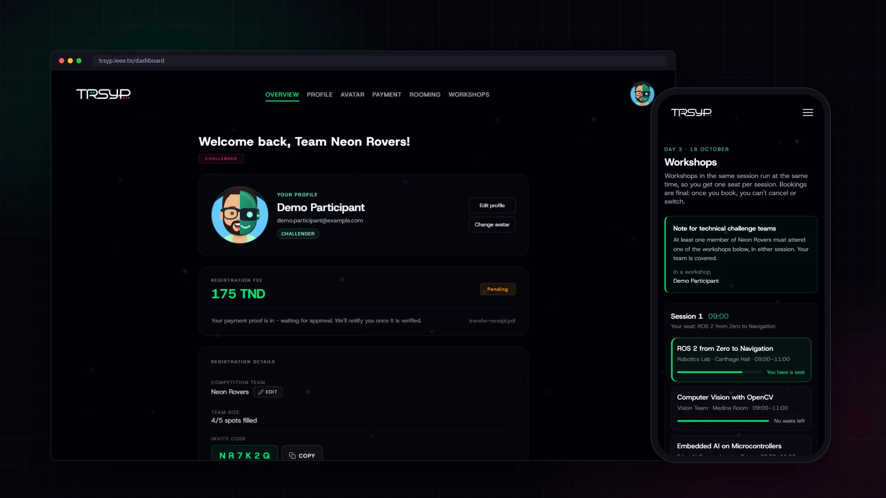

## Contents

- [About](#-about)
- [Features](#-features)
- [A quick tour](#-a-quick-tour)
- [How it works](#-how-it-works): the participant journey and the rules behind each step
- [Domain model](#-domain-model): class diagram of the database
- [Key flows](#-key-flows): sequence diagrams for registration, payment and booking
- [Architecture](#-architecture): deployment, authentication, modules, events
- [Getting started](#-getting-started) · [Deployment](#-deployment) · [Engineering notes](#-engineering-notes) · [Team](#-team)

## 📌 About

**TRSYP 3.0** took place on **16 to 18 October 2026** at Le Royal, Yasmine Hammamet, under the theme
**Human-Robot Symbiosis**. It was organised by the IEEE INSAT Student Branch with the IEEE RAS Tunisia Section.

This repository is the congress's production web platform. It started as the event's public site and grew,
between February and October 2026, into the tool participants used to sign up, form teams, pay, pick a roommate
and book their workshops. The organising committee ran the other side of it (payment review, bans, visa letters,
IEEE checks) from a separate admin portal that shares the same database.

<div align="center">

| **400+** | **3** | **8** | **250+** |
|:---:|:---:|:---:|:---:|
| people used the platform | team activities | months of development | commits |

</div>

## ✨ Features

| | Feature | What it does |
|---|---|---|
| 🌐 | **Public site** | Hero video, three-day program, speakers, workshops, venue, visa help and the three competition tracks with their spec books. |
| 🔐 | **Accounts** | Email/password or Google sign-in through Supabase Auth, with email verification and password reset. |
| 🪪 | **IEEE membership check** | Membership and RAS status are read from IEEE's member API, not from the form, and they set the fee tier. |
| 🤖 | **Hybrid avatar** | Every participant builds a half-human, half-robot avatar that represents them across the site. |
| 👥 | **Teams** | Teams for the Competition, the Technical Challenge and the Adwya × Orange Fablab Challenge, joined with a 6-character code. |
| 💳 | **Payments** | A fee computed from role and membership, receipt upload, and review by the treasurer. |
| 🛏 | **Rooming** | Double rooms formed with a join code, between two participants of the same gender. |
| 🧑‍🏫 | **Workshop booking** | One seat per session, capacity enforced under concurrent load, and a duty check for challenge teams. |
| 🎚 | **Phase switches** | Each feature opens and closes on its own `soon` / `open` / `closed` window, set from environment variables. |

## 📸 A quick tour

> Public pages are captured from the running app. Signed-in pages use a demo account and sample data.

### Home

The landing page opens on the congress's hero video, dates and a countdown.

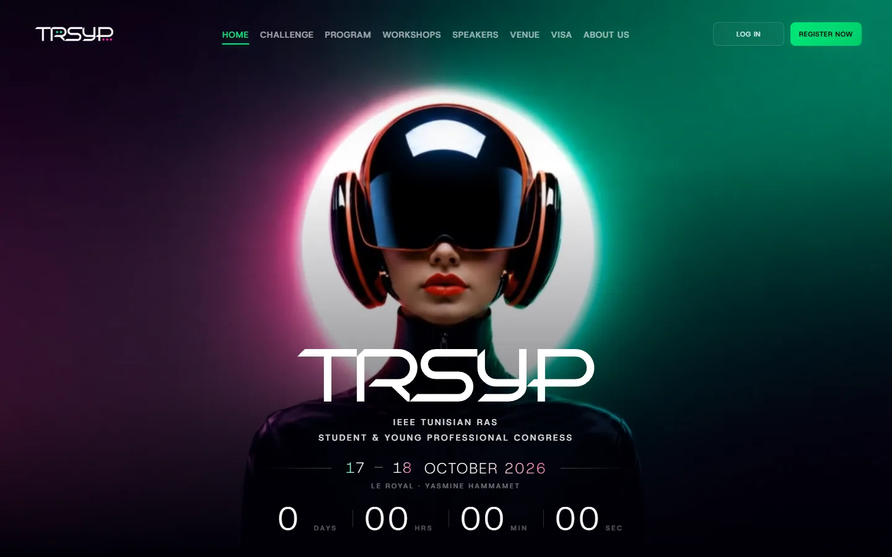

### Dashboard

Everything a participant needs on one page: profile and avatar, fee and payment status, team and invite code.

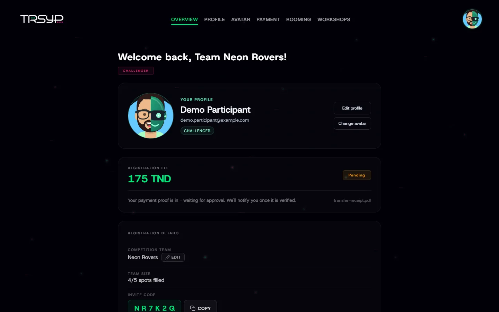

### Payment

The full fee table with the participant's own fee highlighted, the bank details and the receipt upload.

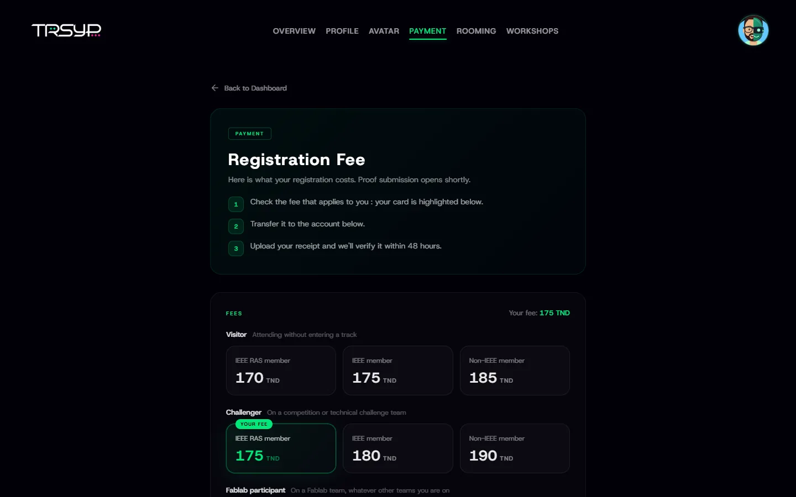

### Workshop booking

Live seat counts, one seat per session, and a note telling challenge teams whether they are covered.

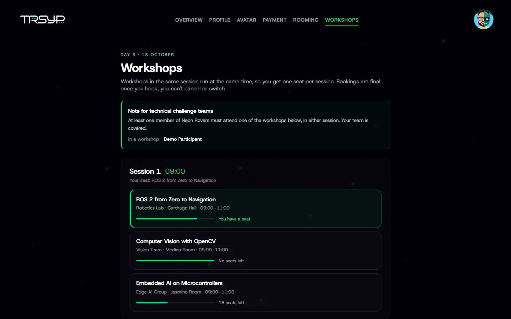

### Rooming

Create a double room and send its code to a roommate, or join theirs.

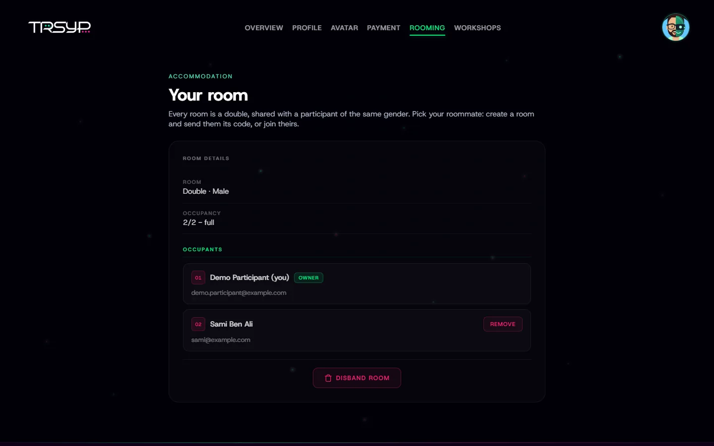

### On a phone

<p align="center">
  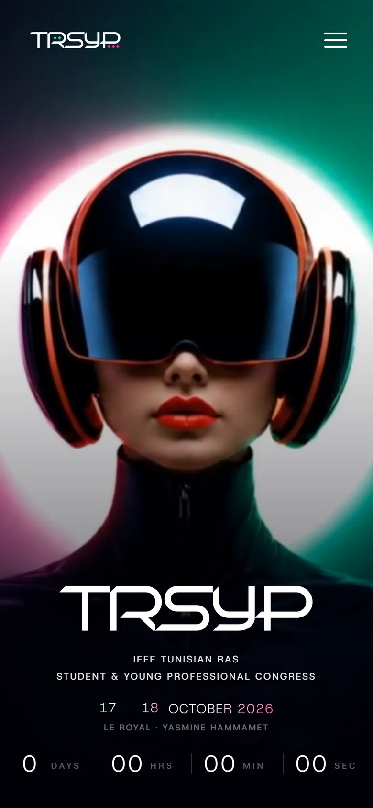
  &nbsp;&nbsp;&nbsp;&nbsp;
  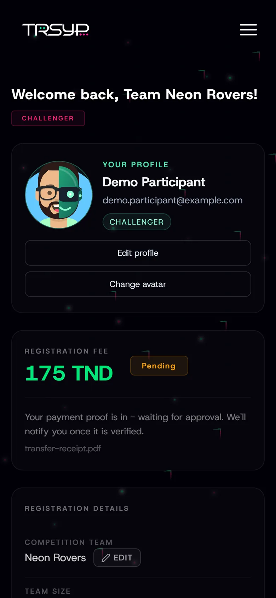
</p>

## 🧭 How it works

### The participant journey

A participant goes through the same steps in order. Each step after the profile is optional and has its own
registration window.

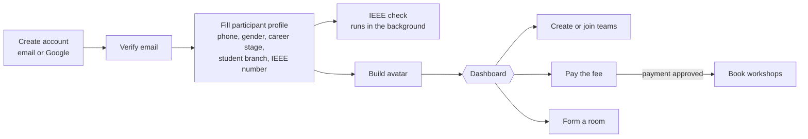

The profile is the only required step. Once it exists, the participant lands on the dashboard and everything else
is done from there. The avatar is required before the dashboard opens, because it is how participants appear to each
other in teams and rooms.

### 1. IEEE membership

Participants don't declare their own membership. They give their IEEE member number (if they have one), and the
backend asks IEEE's member API who they are.

- **Lookup key.** The member number is used first. The account email is the fallback, and only once the participant
  has verified that email.
- **Standing.** IEEE's status is mapped to four standings: `Active` is a **member**, `Applicant` also counts as a
  member (usually waiting for payment), any other past status is **lapsed**, and no record is **not a member**.
- **RAS.** A participant counts as RAS only if they are an *active* member and IEEE lists the RAS society
  (`MEMRA024`) among their societies.
- **Student or Young Professional.** IEEE's grade is ignored on purpose: this is the participant's own answer.
- **When it runs.** Right after registration, whenever the member number changes, on request from the dashboard, and
  in a background sweep every 5 minutes that rechecks unverified or outdated participants, 20 at a time. A failed
  IEEE call writes nothing and is retried later.
- **Until the answer arrives**, a new participant is priced as a non-member.

The admin portal writes to the same `ieee_verifications` table. When it records a result, the backend applies it to
the participant on its next pass, so both sides always agree on how someone is priced.

### 2. Fees

The fee depends on two things: the participant's **role** (what they take part in) and their **tier** (their IEEE
membership).

| Role \ Tier | IEEE RAS member | IEEE member | Non-IEEE |
|---|:---:|:---:|:---:|
| **Visitor**, attending without a team | 170 TND | 175 TND | 185 TND |
| **Challenger**, on a Competition or Technical Challenge team | 175 TND | 180 TND | 190 TND |
| **Fablab participant**, on a Fablab team | 100 TND | 100 TND | 100 TND |

- **Role precedence.** Fablab wins over Challenger, which wins over Visitor. A participant on both a Fablab team and a
  Competition team pays the Fablab fee.
- **Selection.** Only teams that passed the selection phase (`Team.selected`) count. A team that was not selected no
  longer makes its members challengers.
- **Override.** An agreed exception (`Participant.feeOverride`) replaces the table for that one person.
- **Snapshot.** When a receipt is submitted, the fee at that moment is stored with it (`amountSnapshot`), so the
  treasurer reviews the amount the participant actually saw, even if their role or tier changed afterwards.

The table lives in [`backend/.../registration/domain/fees.ts`](backend/src/modules/registration/domain/fees.ts) and is
mirrored in [`lib/fees.ts`](lib/fees.ts), so the dashboard can update the fee the moment someone joins a team,
without waiting for the server.

### 3. Teams

| Activity | Team size | Who can enter |
|---|:---:|---|
| Competition | 3 to 6 | Everyone |
| Technical Challenge | 2 to 6 | Everyone |
| Adwya × Orange Fablab Challenge | 2 to 4 | IEEE members who are also RAS members |

- The creator becomes the **leader** and gets a unique 6-character join code to share.
- A participant can be in **at most one team per activity**, but can be in one team of each. This is a unique index on
  `(participant, activity)` in `team_memberships`, not just a check in the code.
- A leader leads **at most one team per activity**, also enforced by a unique index.
- Members can leave. The leader cannot leave: they can remove members or disband the team, so a team is never left
  without a leader.
- A team cannot grow past the size its leader chose.
- Fablab teams also pick an **axis** (sample preparation, or weighing and dosing) and the leader submits the concept
  dossier from the dashboard, during its own submission window.

### 4. Payments

Payment is by bank transfer. The participant transfers the fee and uploads the receipt. A committee member reviews it.

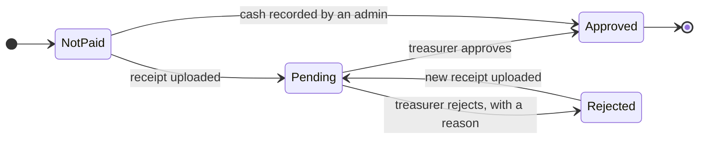

- `Participant.paid` is the single source of truth. Only approving a proof sets it, and rejecting a proof always
  clears it, so a participant can never see "paid" next to a rejected receipt.
- Only one proof can be pending at a time, and none can be sent once the payment is confirmed.
- Rejected proofs are kept, so the next submission can be compared with the one that was turned down.
- Cash has no receipt: the admin who receives it records it, and it is stored already approved.
- After approval, the treasurer records how the money actually arrived (bank transfer, internal fund or cash).
- Once a participant has paid, their profile is locked and their account cannot be deleted without a refund first.

### 5. Rooming

- Every room is a **double**. The creator becomes the owner and gets a 6-character code to send to their roommate.
- The room takes the owner's **gender**, and only a participant of the same gender can join. A participant cannot
  change their gender while they are in a room, so this never goes out of date.
- A participant is in **at most one room**.
- Joining locks the room row for the transaction, so two people racing for the last spot cannot both get it.
- The owner can remove the roommate or disband the room. Deleting the room frees the roommate automatically.

### 6. Workshops

Day 3 has two workshop sessions. Workshops in the same session run in parallel.

- A participant gets **one seat per session**, enforced by a unique index on `(participant, session)`.
- Bookings are **final**: no cancelling, no switching.
- Booking needs a **confirmed payment** (or a payment waiver granted by the committee). Banned participants cannot book.
- **Team duty.** Each selected Technical Challenge team needs at least one member in a workshop, in either session,
  or its student branch loses points (`WORKSHOP_SB_PENALTY`). The team sees whether it is covered. This rule is
  reported to the organisers, not enforced by the booking.
- How capacity holds under a rush is explained in [Key flows](#workshop-booking-under-load).

### 7. Registration windows

Every feature reads its own window from an environment variable, so the committee could open and close each step
without a code change.

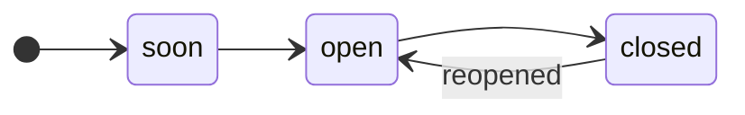

- `soon` and `closed` both block creating and joining. They only change the message shown.
- In `closed`, existing teams stay visible and manageable. Nobody can create or join new ones.

## 🗂 Domain model

The database is PostgreSQL on Supabase, described in [`backend/prisma/schema.prisma`](backend/prisma/schema.prisma) and
versioned with Prisma migrations. `Participant` is the centre of the model: everything a participant does hangs off it.
The two diagrams below show the models behind the features above, with their main fields.

#### Identity and membership

Who someone is: their account, their participant profile, what IEEE says about them, and, for international
participants, their travel and visa details. `Admin` is separate: committee members are not participants.

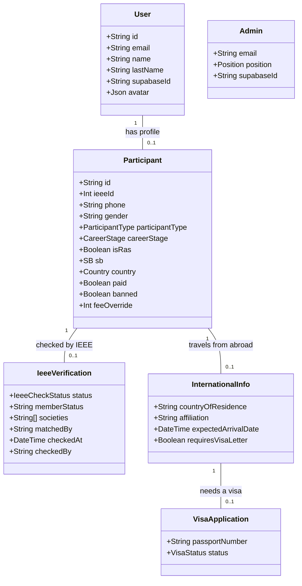

#### Activities

What a participant takes part in: teams, payment, room and workshop seats.

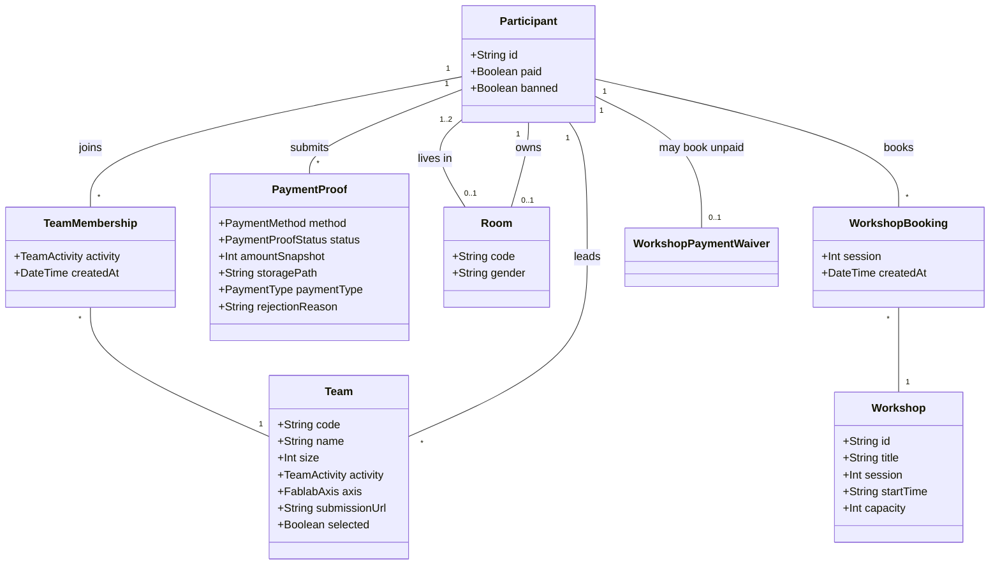

<details>
<summary><b>Enumerations</b></summary>

| Enum | Values |
|---|---|
| `ParticipantType` | `NonIEEE`, `Student`, `YoungProfessional` |
| `CareerStage` | `Student`, `YoungProfessional` |
| `TeamActivity` | `COMPETITION`, `CHALLENGE`, `FABLAB` |
| `FablabAxis` | `SAMPLE_PREPARATION`, `WEIGHING_DOSING` |
| `IeeeCheckStatus` | `VERIFIED`, `MISMATCH`, `INACTIVE`, `NOT_FOUND` |
| `PaymentMethod` | `BANK_TRANSFER`, `D17`, `FLOUCI`, `CASH` (only bank transfer is offered in the UI) |
| `PaymentType` | `BANK_TRANSFER`, `INTERNAL_FUND`, `CASH` |
| `PaymentProofStatus` | `PENDING`, `APPROVED`, `REJECTED` |
| `VisaStatus` | `Pending`, `Approved`, `Rejected`, `LetterSent` |

</details>

**Rules held by the database itself**, so they hold even under concurrent requests:

| Constraint | Rule |
|---|---|
| `team_memberships (participant_id, activity)` unique | One team per activity per participant |
| `teams (leader_id, activity)` unique | One led team per activity |
| `workshop_bookings (participant_id, session)` unique | One workshop seat per session |
| `rooms.owner_id` unique, `participants.room_id` single column | One owned room, one room per participant |
| `participants.ieee_id`, `participants.phone` unique | No two profiles with the same IEEE number or phone |
| `TeamMembership.activity` copied from `Team.activity` | Makes the first rule a plain unique index (a team's activity never changes) |
| `WorkshopBooking.session` copied from `Workshop.session` | Same idea for one seat per session |

## 🔁 Key flows

### Sign-up and registration

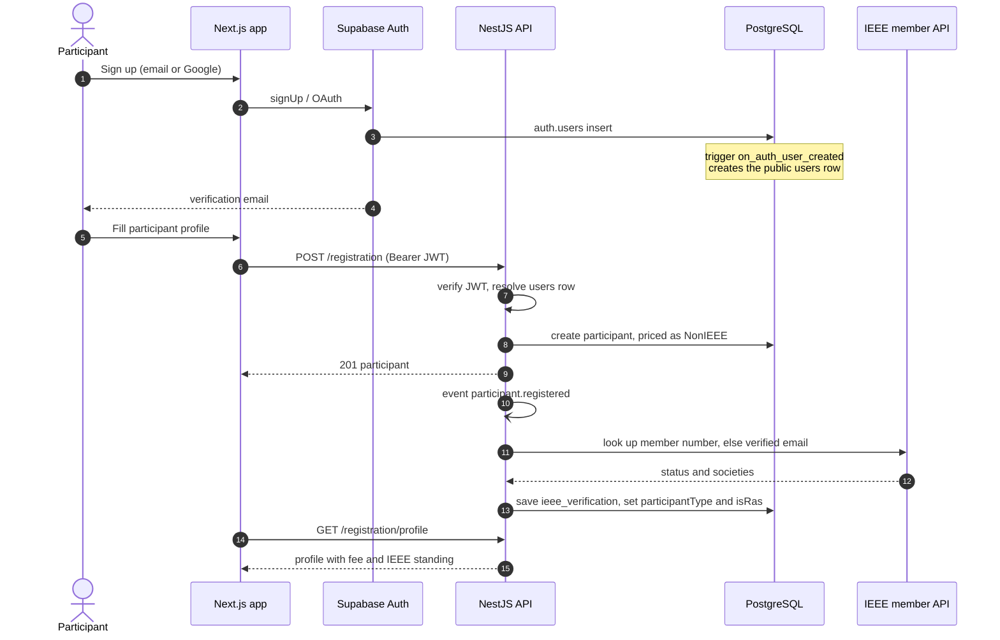

The IEEE check happens after the response, through an internal event, so registration never waits on IEEE's API and
never fails because of it.

### Payment review

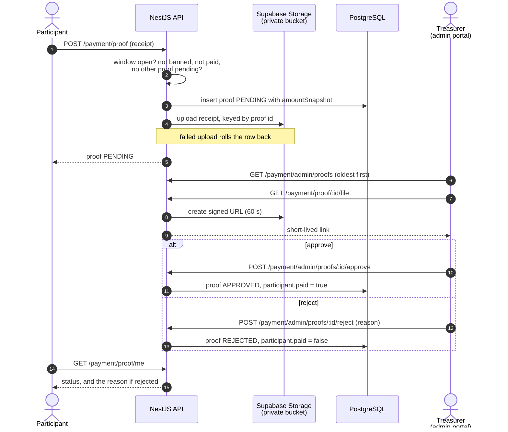

### Workshop booking under load

When booking opens, many people try to book the same popular workshop within seconds.

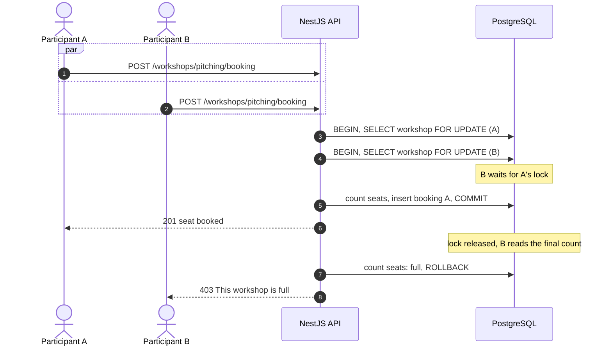

- Every booking locks exactly one row, the workshop, so bookings cannot deadlock.
- The unique `(participant, session)` index catches a double booking even if two requests from the same person arrive
  at once.
- Transaction timeouts are raised above Prisma's defaults so the queue drains during a rush. If it still times out,
  the participant is asked to try again in a moment instead of getting an error.

## 🏗 Architecture

### Deployment

One Docker image runs both applications in a single Render web service. Next.js listens on the public port and
proxies `/api/*` and `/health` to NestJS, so the browser only ever talks to one origin.

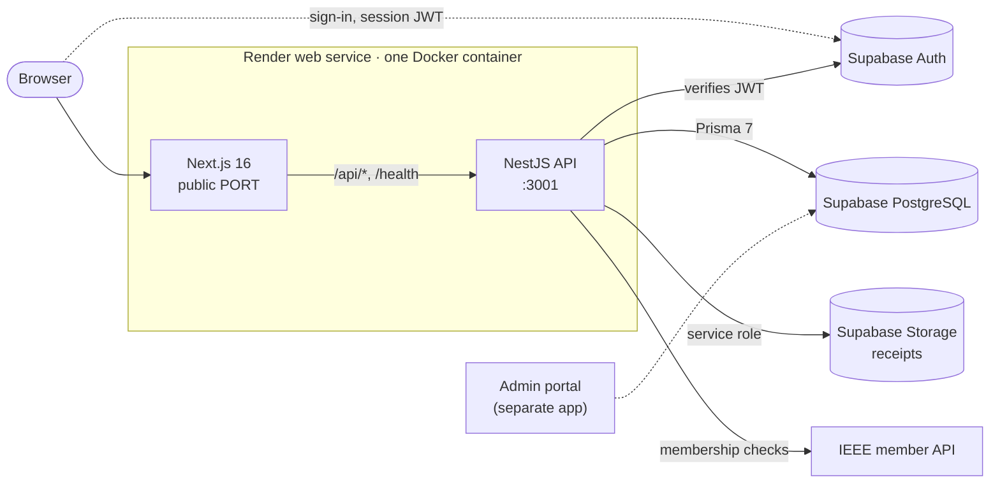

### Authentication and authorisation

- **Sign-in is Supabase's job.** The browser signs in with Supabase Auth and sends the session's access token as a
  `Bearer` header on every API call.
- **The API verifies the token itself.** ES256 tokens are checked against Supabase's public keys (JWKS, cached), and
  legacy HS256 tokens against the project secret. Expired tokens are refused.
- **From Supabase user to database user.** A database trigger creates the `users` row when someone signs up. The JWT
  strategy then finds that row from the token's subject, and recreates it if it is ever missing, so a valid token is
  never locked out.
- **Admins** are whoever is listed in the `admins` table. Admin routes check that table, not a claim in the token.
- **Receipts** are in a private storage bucket that only the API can reach, with the service-role key. Reviewers get
  a signed link that expires after 60 seconds.
- **Input** is validated with `class-validator` DTOs; unknown fields are stripped before they reach a service.
- **Abuse.** Helmet sets security headers, and a global rate limit allows 50 requests per minute per client.

### Backend modules

The API is a modular monolith: one NestJS app, one folder per domain, each with its own controller, service, DTOs
and domain rules.

| Module | Responsibility |
|---|---|
| [`auth`](backend/src/modules/auth) | Supabase JWT strategy, user sync, profile and avatar, admin guard |
| [`registration`](backend/src/modules/registration) | Participant profile, fee rules, teams for the three activities, Fablab submission, bans |
| [`ieee`](backend/src/modules/ieee) | IEEE member API client, membership verification and the background sweep |
| [`payment`](backend/src/modules/payment) | Receipt upload and storage, review queue, cash payments |
| [`rooming`](backend/src/modules/rooming) | Double rooms with join codes |
| [`workshop`](backend/src/modules/workshop) | Day-3 workshop booking and team workshop duty |
| [`visa`](backend/src/modules/visa) | Visa applications for international participants |
| [`admin`](backend/src/modules/admin) | Admin accounts |

Modules react to each other through **domain events** (`@nestjs/event-emitter`) instead of calling each other for
side effects. The `registration` module announces what happened, and the `ieee` module listens:

| Event | Emitted when | Listener |
|---|---|---|
| `participant.registered` | A participant profile is created | `ieee` runs the first membership check |
| `participant.ieee_details_changed` | The member number changes | `ieee` checks again |

The `payment` module also emits `payment.proof.submitted` and `payment.status.updated`, and `registration` emits
`participant.paid`. Nothing listens to them yet: they are the hook for notifications.

### Frontend

- **Next.js App Router.** The dashboard talks to the API through a typed client in [`lib/api/`](lib/api), one service
  per backend module, with types that mirror the API's responses.
- **State** lives in small Zustand stores ([`lib/store/`](lib/store)): the auth session, the participant's
  registration, and their teams.
- **Windows** are read in [`lib/config.ts`](lib/config.ts) from `NEXT_PUBLIC_*` variables, so a closed feature is
  hidden in the UI as well as refused by the API.

### Tech stack

| Layer | Tools |
|---|---|
| Frontend | Next.js 16 (App Router), React 19, TypeScript, Zustand, Motion, Avataaars |
| Backend | NestJS 10, Prisma 7 with the `pg` adapter, class-validator, Joi config validation, Passport JWT, `@nestjs/event-emitter` |
| Data and auth | Supabase PostgreSQL, Supabase Auth (email and Google), Supabase Storage |
| Security | Helmet, `@nestjs/throttler`, JWKS verification, admin guard |
| API docs | Swagger at `/api/docs` outside production |
| Tests | Jest, with unit tests for fees, IEEE membership, payments, registration, rooming and workshops |
| Delivery | Multi-stage Dockerfile, Render, GitHub Actions deploy hook |

### Project structure

```text
.
├── app/                 Next.js routes (public pages, /register, /dashboard)
├── components/          Page and section components
├── lib/
│   ├── api/             Typed client for every backend endpoint
│   ├── store/           Zustand stores (auth, registration, teams)
│   ├── supabase/        Browser Supabase client and email callbacks
│   ├── fees.ts          Fee table, mirrored from the backend
│   └── config.ts        Runtime config and registration windows
├── backend/
│   ├── prisma/          Schema, migrations, seed
│   └── src/
│       ├── common/      Guards, decorators, pipes, event names
│       └── modules/     One folder per domain
│           └── <module>/
│               ├── controller/   HTTP routes
│               ├── service/      Use cases and transactions
│               ├── domain/       Pure rules (fees, IEEE mapping)
│               └── dto/          Validated request and response shapes
├── public/              Images, hero video, partner and speaker photos
├── scripts/             Image optimisation, production start script
├── Dockerfile           Builds both apps into one image
└── render.yaml          Render service definition
```

## 🚀 Getting started

Requires **Node.js 20 or newer** and a Supabase project.

```bash
git clone https://github.com/IEEE-INSAT/TRSYP3.0.git
cd TRSYP3.0
cp .env.example .env        # fill in the Supabase values
```

Start the API:

```bash
npm --prefix backend ci
cd backend
npx prisma generate
npm run start:dev
```

Start the frontend in another terminal:

```bash
npm ci
npm run dev
```

The frontend runs at `http://localhost:3000` and the API at `http://localhost:3001`. Both applications and Prisma
read the single root `.env` file.

### Configuration

[`.env.example`](.env.example) documents every variable. The ones you will touch most are the windows:

| Variable | Values | Controls |
|---|---|---|
| `NEXT_PUBLIC_PARTICIPANT_REGISTRATION_OPEN` | `true` / `false` | Participant sign-up |
| `NEXT_PUBLIC_COMPETITION_PHASE`, `COMPETITION_REGISTRATION_PHASE` | `soon` / `open` / `closed` | Competition teams |
| `NEXT_PUBLIC_CHALLENGE_PHASE`, `CHALLENGE_REGISTRATION_PHASE` | `soon` / `open` / `closed` | Technical Challenge teams |
| `NEXT_PUBLIC_FABLAB_PHASE`, `FABLAB_REGISTRATION_PHASE` | `soon` / `open` / `closed` | Fablab teams |
| `NEXT_PUBLIC_FABLAB_SUBMISSION_PHASE`, `FABLAB_SUBMISSION_PHASE` | `soon` / `open` / `closed` | Fablab concept submission |
| `NEXT_PUBLIC_ROOMING_PHASE`, `ROOMING_PHASE` | `soon` / `open` / `closed` | Rooming |
| `WORKSHOP_BOOKING_PHASE` | `soon` / `open` / `closed` | Workshop booking |
| `WORKSHOP_SB_PENALTY` | number | Points a student branch loses when its team skips workshops |
| `PAYMENT_PROOF_OPEN` | `true` / `false` | Receipt upload (read per request, no rebuild) |
| `IEEE_CLIENT_ID`, `IEEE_CLIENT_SECRET` | secret | IEEE membership checks (without them, everyone is priced as a non-member) |

Keep each `NEXT_PUBLIC_*` window aligned with its backend twin. `NEXT_PUBLIC_*` values are compiled into the browser
bundle, so changing one needs a frontend rebuild.

### Checks

```bash
cd backend
npm run build
npm test -- --runInBand

cd ..
npm run typecheck
npm run lint
npm run build
```

## ☁️ Deployment

The root [`Dockerfile`](Dockerfile) builds both applications. Next.js listens on Render's public `PORT`; NestJS
listens internally on port `3001`. [`docker-compose.yml`](docker-compose.yml) gives the same topology for local
container testing:

```bash
docker compose up --build    # http://localhost:3000
```

[`render.yaml`](render.yaml) defines the single Docker service. Provide every variable marked `sync: false` before
deploying. Every push to `main` triggers the Render deploy hook through
[`.github/workflows/deploy-render.yml`](.github/workflows/deploy-render.yml).

Supabase authentication emails are configured in the Supabase dashboard, not in Render. Set the public frontend as
the Auth Site URL and allow:

```text
https://rtc.ieee.tn/verify-email/
https://rtc.ieee.tn/reset-password/
```

For local development, also add this under **Supabase Dashboard → Authentication → URL Configuration → Redirect URLs**:

```text
http://localhost:3000/**
```

Without it, Supabase ignores the localhost `redirectTo` the app asks for and falls back to the production Site URL.

## 🧠 Engineering notes

Decisions that mattered once real traffic arrived:

- **Let the database hold the rules.** "One team per activity", "one seat per session" and "one room per person" are
  unique indexes, not `if` statements. Two requests arriving at the same millisecond cannot both pass.
- **Lock one row, never two.** Workshop booking and room joining each lock a single row, which makes them safe under
  concurrency without any risk of deadlock.
- **Fees from the source.** The tier comes from IEEE's records, so nobody gets the cheaper fee by ticking a box, and the
  admin portal and the API price everyone the same way.
- **Slow dependencies off the request path.** The IEEE check runs from an event and a background sweep, so IEEE being
  slow or down never blocks a registration.
- **One source of truth for "paid".** Receipts are an audit trail. Only `Participant.paid` says whether someone has
  paid, and only approval changes it.
- **Switches without a rebuild.** Backend windows such as `PAYMENT_PROOF_OPEN` are read per request.
- **One origin.** Next proxies the API, so there is no CORS to manage in production and one Render service hosts everything.
- **Images ready ahead of time.** On-the-fly image optimisation was too slow on Render's free instance, so images are
  converted to WebP with [`scripts/optimize-images.mjs`](scripts/optimize-images.mjs) before they are committed.

## 👥 Team

Built by the IEEE INSAT Student Branch web team:

<table>
  <tr>
    <td align="center"><a href="https://github.com/MakkiAloulou"><br><b>Makki Aloulou</b></a></td>
    <td align="center"><a href="https://github.com/AchourMedAmine"><br><b>Mohamed Amine Achour</b></a></td>
    <td align="center"><a href="https://github.com/yassinekolsi"><br><b>Yassine Kolsi</b></a></td>
  </tr>
</table>

<br><br>

<div align="center">
  <sub>IEEE INSAT Student Branch × IEEE RAS Tunisia Section · TRSYP 3.0 · 2026</sub>
</div>
